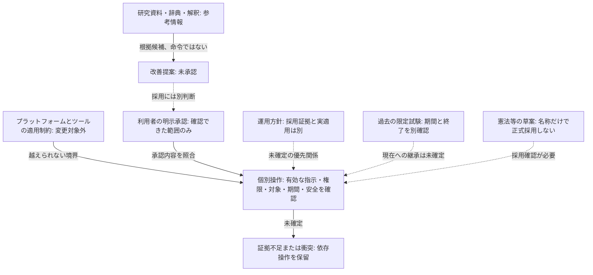

# 規則の地位と依存の図

これは研究用の分類図。分類の順番は権威の順位を表さない。適用されるプラットフォーム・ツール側の制約を、研究リポジトリ内の変更で上書きすることはできない。内部制約の原文をここへ転載しない。

実線は図中で明記した関係だけを示す。点線は未確定・条件付きであり、自動的な昇格・適用を表さない。研究分類A言語、B哲学、C行動、D憲法・規則運用は資料を探す軸で、権限順位ではない。Stage 1の5領域はDに憲法と規則運用を合わせる対応となり、資料IDは維持する。

## 公開原証拠で確定できること

[公開計画](../stage1/public-index.json) は研究計画でNOT_A_RULE。その境界4条項を[台帳](public-relations.json)のPLAN-001〜004として参照するが、制定しない。[Stage 1分類方針](../stage1/governance-map.md)は、承認者・日時・範囲の照合と本文自己申告を分けている。

本人限定の条項原文・制定経緯・承認・適用範囲は別台帳で照合する。全体承認が不明な文書や古い試験を、この図で現行の正式規則に昇格させない。資料同士の優先関係が確かめられない場合はUNKNOWNとし、研究者独自の階層を補わない。
